# Sozlamalar qo'llanmasi (skrinshotlar bilan)

> Qaysi sozlama qayerda, qanday o'zgartiriladi va nimaga ta'sir qiladi — har biri skrinshot bilan. Rasmni bossangiz,
> shu sahifada ko'rish oynasi ochiladi: g'ildirak yoki +/− — kattalashtirish, sudrash — siljitish, ikki marta bosish —
> 200% / moslash, ← → — bobdagi boshqa rasmlar, Esc yoki ✕ — yopish.

> Skrinshotlar **namunaviy ma'lumot** bilan olingan (sahifa ko'rinishi prod bilan bir xil; guruh, vazifa, ism-familiyalar
> misol uchun). Telefon raqamlari va parollar rasmlarda yashirilgan.

## Menyuda qayerda

Barcha sozlamalar chap menyuda. **Support bot** bo'limi ochilganda: savollar, PRBC vazifalari va sozlash bandlari.

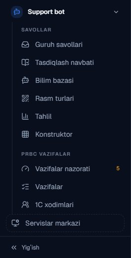

| Nima sozlanadi | Menyu yo'li |
|---|---|
| Botlar, guruhlar, javob berish, rasmlar, tarix, vazifa rejimi, xodimlar, umumiy | Support bot → Sozlash → **Botlar va sozlamalar** |
| PRBC ulanishi, vazifa muddati, guruh → loyiha / ijrochi, mijoz holati | Support bot → Sozlash → **PRBC sozlamalari** |
| Vazifalarni kuzatish | Support bot → PRBC vazifalar → **Vazifalar nazorati** |
| Bilim bazasi (javoblar) | Support bot → Savollar → **Bilim bazasi** |
| Inventar katalogi va loginlar | IT inventarizatsiya → **Katalog**, **Loginlar va huquqlar** |
| Panel foydalanuvchilari, AI provayderlar | Mas'uliyat platformasi → Tizim → **Sozlamalar** |

---

## 1. Support bot sozlamalari

Support bot → **Botlar va sozlamalar**. Chapda bo'limlar: Botlar, Guruhlar, Javob berish, Rasmlar, Guruh tarixi,
PRBC vazifalari, Xodimlar, Umumiy. Har o'zgarishdan keyin **Saqlash**.

### 1.1 Botlar

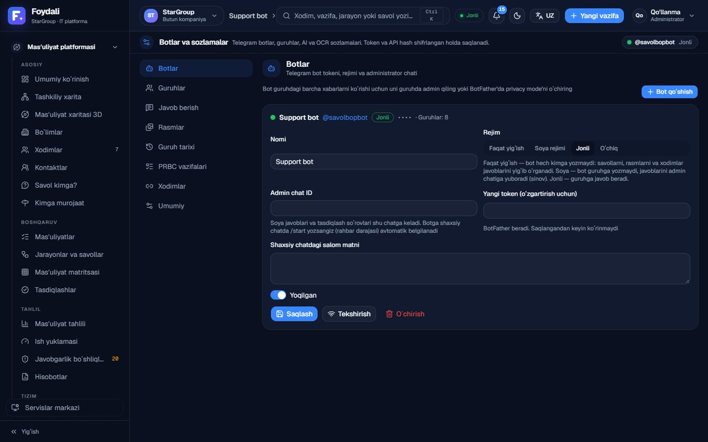

- **+ Bot qo'shish** — yangi Telegram bot (token BotFather'dan).
- **Nom** va **Admin chat ID** — soya rejimidagi javob takliflari va ogohlantirishlar shu chatga boradi.
- **Rejim** — butun bot uchun: *Faqat yig'ish*, *Soya* (javob faqat admin chatiga), *Jonli* (guruhga javob), *O'chiq*.
- **Yangi token** — faqat o'zgartirish uchun; token shifrlangan saqlanadi va qayta ko'rsatilmaydi.
- **Shaxsiy chatdagi salom matni**, **Yoqilgan** kaliti.
- **Saqlash**, **Tekshirish** (token ishlayaptimi, bot barcha xabarlarni ko'radimi), **O'chirish**.

### 1.2 Guruhlar

**28.11 dan — ixcham jadval:** har guruh bitta qator — guruh (bot admini / oxirgi xabar), 7 kunlik savollar, rejim
(ro'yxat), «Tahlilga» va «PRBC vazifa» kalitlari, «Eski guruh → qaysi guruhga yo'naltiriladi». Qator oxiridagi ⌄ tugmasi
— yo'naltirish va havola tafsilotlari. (Quyidagi rasmlar avvalgi kartochka ko'rinishidan — mazmuni o'zgarmagan.)

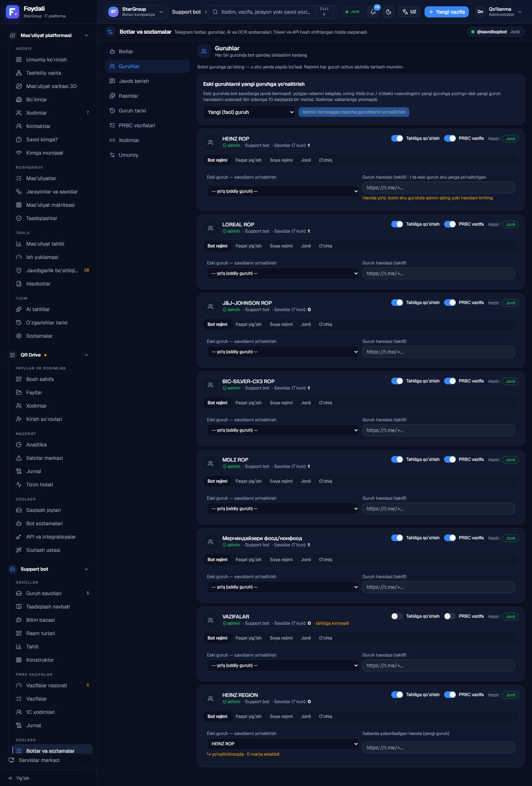

Har guruh kartasi:

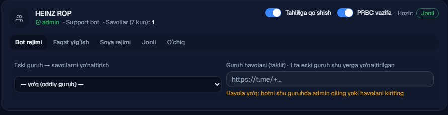

| Element | Nima qiladi |
|---|---|
| **Tahlilga qo'shish** | O'chirilsa — guruh savollari statistikaga kirmaydi (test guruhi uchun) |
| **PRBC vazifa** | O'chirilsa — guruh savollaridan vazifa ochilmaydi. **VAZIFALAR — o'chiq**, ROP guruhlari — yoqiq |
| **Rejim** (Bot rejimi / Faqat yig'ish / Soya / Jonli / O'chiq) | Shu guruh uchun alohida; "Bot rejimi" — botning umumiy rejimini oladi. "Hozir:" — amaldagi rejim |
| **Eski guruh — savollarni yo'naltirish** | Yangi guruhni tanlasangiz, bu guruh **eski** bo'ladi: bot javob bermaydi, odamni yangi guruhga yo'naltiradi |
| **Guruh havolasi** | Taklif havolasi (yo'naltirish xabarida yuboriladi). Bot admin bo'lsa o'zi oladi |
| **admin** belgisi | Bot guruhda admin — barcha xabarlarni ko'radi. Admin bo'lmasa — admin qiling |

Eski guruh shunday ko'rinadi (PRBC vazifa kaliti o'chiq va bloklangan):

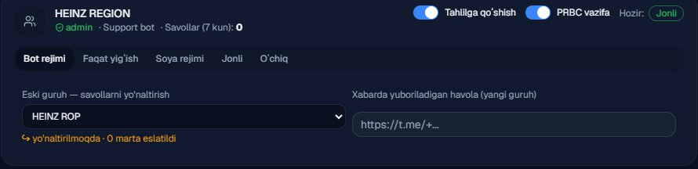

Bir nechta eski guruhni birdan yo'naltirish — sahifa tepasidagi blok:

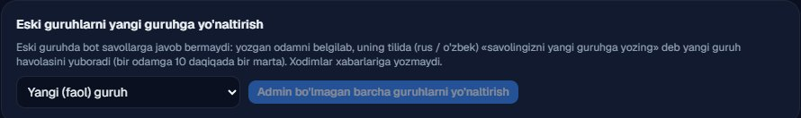

### 1.3 Javob berish

**28.11 dan — yig'iladigan bo'limlar:** Ish vaqti, Javob siyosati, Toifa bo'yicha mas'ul (ochiq), Guruhdagi javob,
«Hal bo'ldimi?», O'rganish, Aniqlik va tezlik (bosilsa ochiladi). Kalitlar va bo'limdagi raqamlar (maydondan
chiqqanda) darhol saqlanadi; qo'lda saqlanadiganlari o'zgarsa pastda bitta yopishqoq panel chiqadi: «N ta o'zgarish
saqlanmagan — Saqlash / Bekor». **Toifa bo'yicha mas'ul** qatorida — oxirgi 30 kunda shu toifada nechta savol bo'lgani
va kim haqiqatda javob bergani; tanlangan mas'ul ular orasida bo'lmasa — sariq ⚠ (mas'ulni tekshiring).

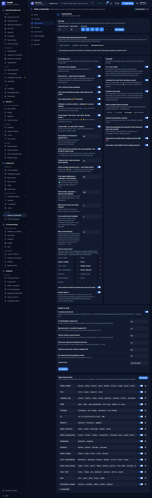

Sahifa yuqoridan pastga (standart qiymatlar — [Support bot bobi](/docs/support-bot#barcha-sozlamalar-botlar-va-sozlamalar)):

1. **Ish vaqti** — boshlanishi/tugashi va ish kunlari: eslatmalar va "hal bo'ldimi?" so'rovlari faqat shu vaqtda.
2. **Bot chatda qaysi savollarga javob beradi** — *Faqat standart* / *Standart + bilim bazasi* / *Hammasi (AI ham)*.
3. **Guruhdagi javob** (chap ustun) — savol beruvchini / supervayzerni / mas'ulni belgilash, "qabul qilindi",
   👍/👎, "rahmat" → yopish, test eslatmasi, "⚠️ Xato javob" tugmasi, skrinshotlarni saqlash, **"hal bo'ldimi?"**
   (necha daqiqadan keyin), reaksiya — qabul qilindi, xodimdan so'rash, qayta so'rash, eslatmalar soni, javobni yig'ish,
   bitta suhbat oynasi.
4. **Toifa bo'yicha mas'ul** (chap ustun pastida) — Klient, Aksiya, Tovar, Vizit, Marshrut, Zakaz, To'lov, Qoldiq,
   Kirish va boshqalar. **PRBC vazifa ijrochisi ham shundan aniqlanadi** (aksiya, to'lov, qoldiq → Saidabror;
   login → Xusniddin). Mas'ul — bitta xodim, jamoaning bitta a'zosi yoki **butun jamoa** (har jamoa ro'yxati boshida
   «Butun jamoa: Pro-target (Guzel, Eldar)»): butun jamoa tanlansa, javobda va vazifada uning barcha a'zolari
   belgilanadi. Jamoaga qo'shilgan yakka xodimlar (masalan, Dasturchilar — Kamoliddin, Timur) ham shu ro'yxatda.
   Har toifada ikkinchi ustun — **zaxira mas'ul** (aralash ishlar uchun, masalan aksiya): javobda asosiy bilan birga
   belgilanadi («Javob beradi: @asosiy · zaxira: @zaxira»), PRBC vazifasida kuzatuvchi bo'ladi. Standart — zaxirasiz;
   asosiy tanlanmagan toifada zaxira tanlab bo'lmaydi.
5. **O'rganish** (o'ng ustun) — o'z-o'zini o'qitish, javoblarni har safar boshqacha yozish, oraliq xabar, xodim
   tuzatishi darhol qo'llanadigan daraja, xodim javoblaridan o'rganish, admin chatiga nomzodlar va soya javoblari.
6. **Aniqlik va tezlik** — AI asosiy javob beradi va chegarasi (95%), bazadan javob chegarasi (72%), takroriy rasmlar
   oynasi (90 s), ketma-ket xabarlar (12 s), qoida chegarasi (60%), bir vaqtda savollar (10), javob imzosi;
   **Semantik qidiruv (AI'siz)** kaliti (standart o'chiq) va chegarasi (tavsiya 94%) — [Support bot](/docs/support-bot), 4a.
7. **Teglar (savol turlari)** — tahlil uchun toifalar: nomi va kalit so'zlar (vergul bilan; regex uchun `re:`).

### 1.4 Rasmlar

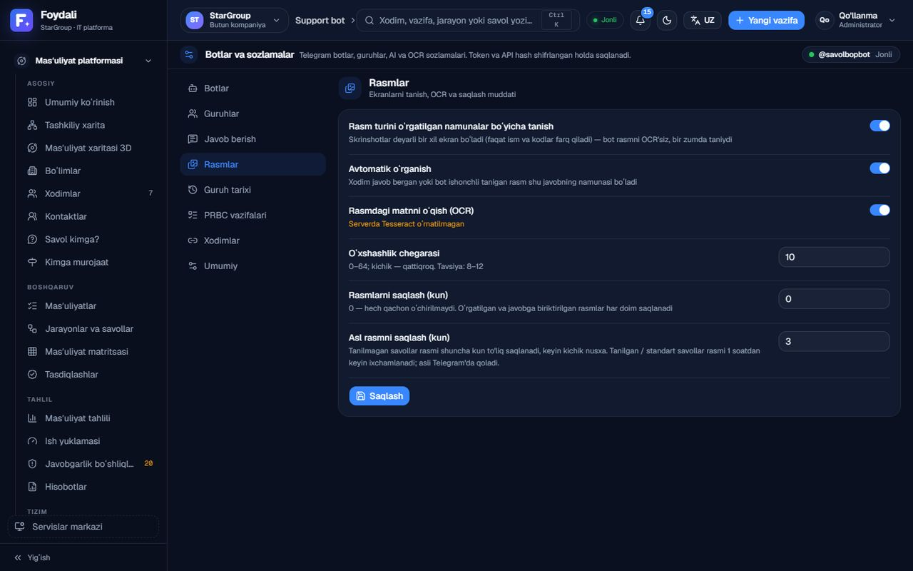

OCR (rasmdagi yozuv), rasm turini namunalar bo'yicha tanish va chegarasi, avtomatik o'rgatish, asl rasm va eskizni
saqlash muddati.

### 1.5 Guruh tarixi

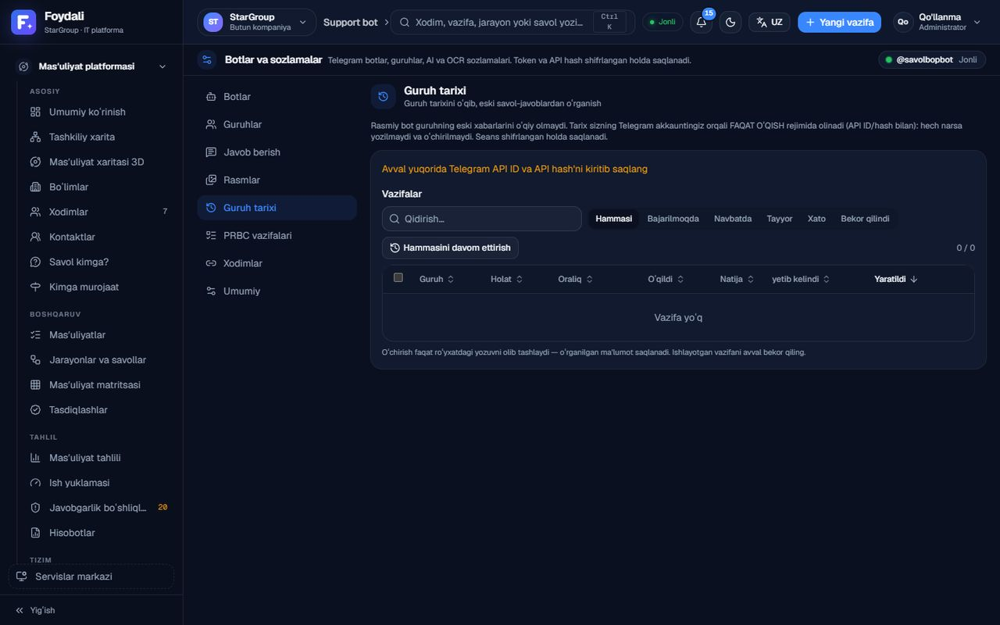

Telegram akkaunt orqali **faqat o'qish** rejimida guruhlarning eski savol-javoblari olinadi va bot ulardan o'rganadi.
Necha kunlik, rasmlar ham, tungi oyna.

### 1.6 PRBC vazifalari (Support tomoni)

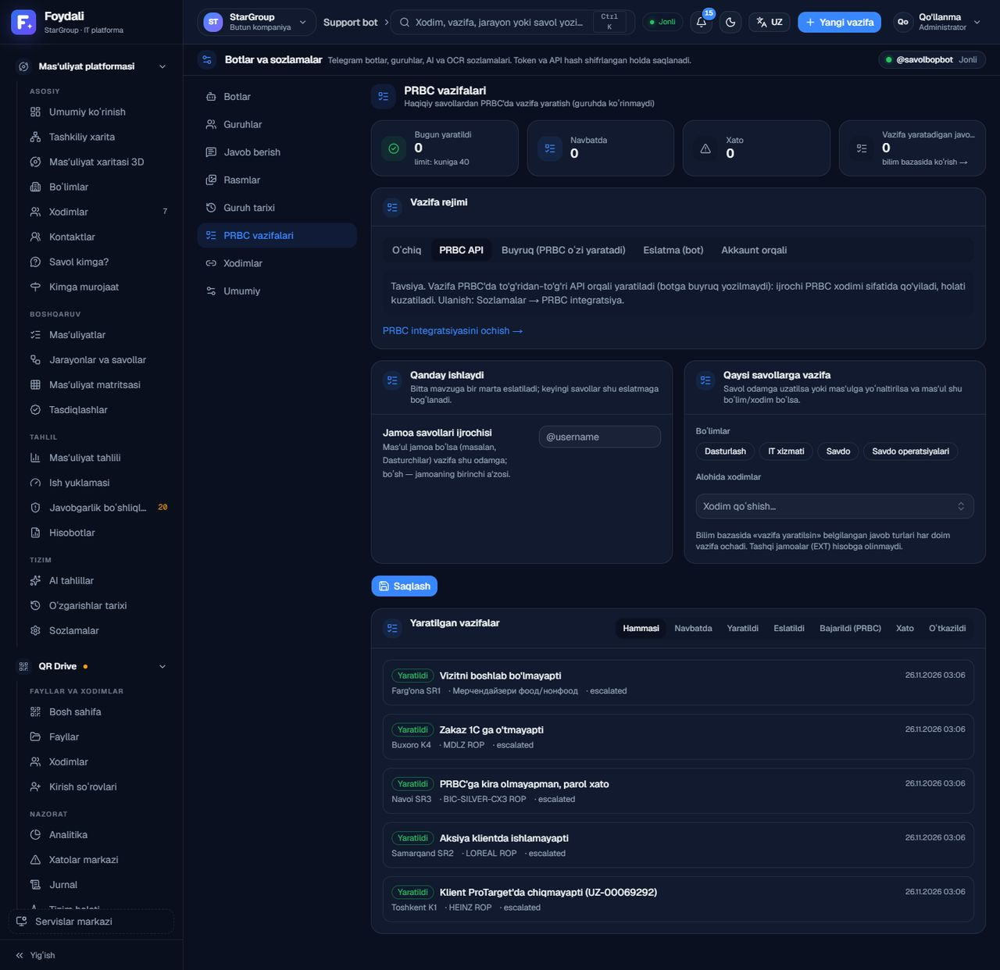

Vazifa rejimi — **PRBC API** bo'lishi kerak (tizim vazifani o'zi ochadi va kuzatadi):

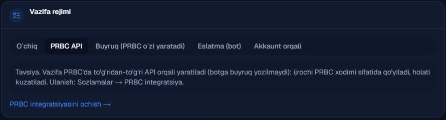

Qaysi savollarga vazifa (eski usul — mas'ul tanlangan bo'limda bo'lsa). Hozir "odamga uzatilgan har savolga vazifa"
yoqiq (PRBC sozlamalarida), shuning uchun bu bo'limlar qo'shimcha:

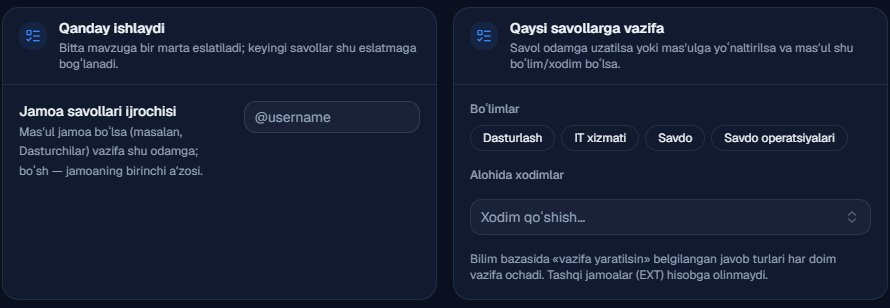

Pastda — **yaratilgan vazifalar** ro'yxati (navbatda / yaratildi / bajarildi / xato).

### 1.7 Xodimlar va Umumiy

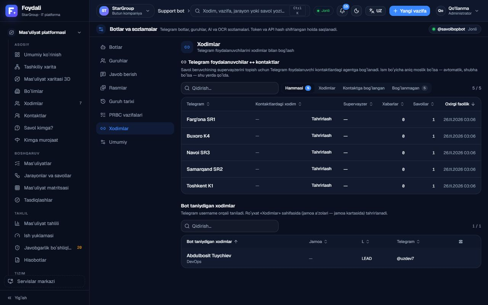

**Xodimlar** — Telegram foydalanuvchilari kim (xodim yoki agent), xodimlar ro'yxati va bog'lanish.

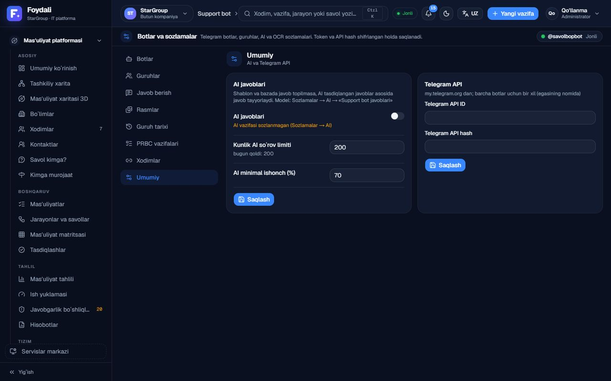

**Umumiy** — **AI javoblari** (yoqish), kunlik AI so'rov limiti (200), AI minimal ishonch (70%) va **Telegram API**
(API ID va hash — guruh tarixini o'qish uchun; shifrlangan saqlanadi). AI provayder va kalitlari — Mas'uliyat
platformasi → Sozlamalar → AI (6-bo'lim).

---

## 2. PRBC sozlamalari

Support bot → Sozlash → **PRBC sozlamalari**. Sahifa tepasidagi panel orqali Nazorat, Vazifalar, 1C xodimlari,
Jurnalga o'tiladi.

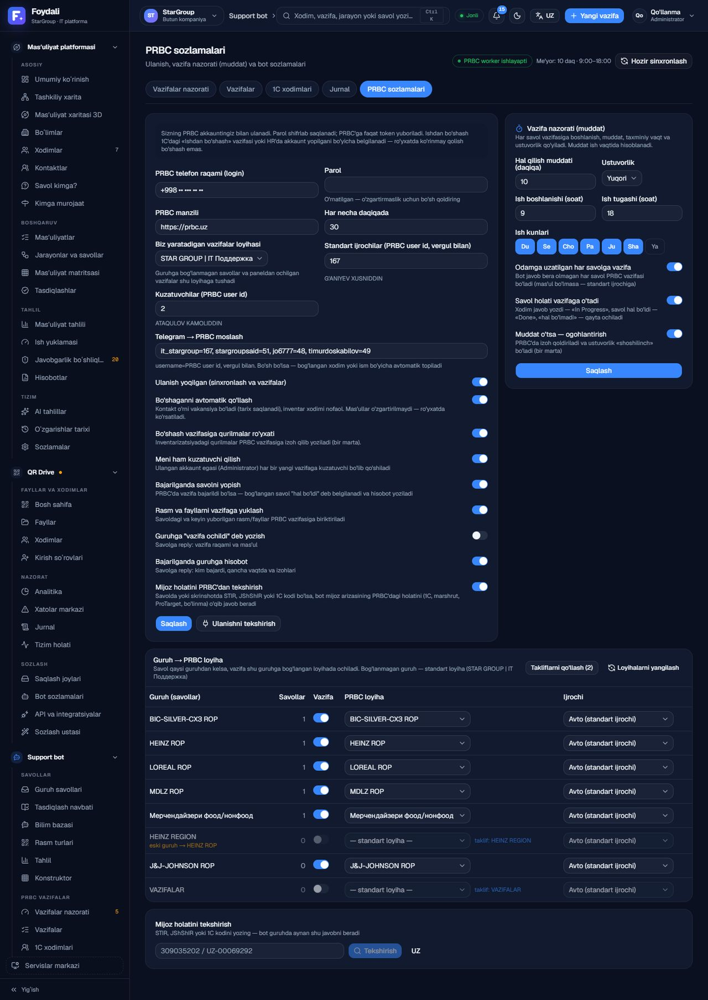

### 2.1 Ulanish va asosiy sozlamalar

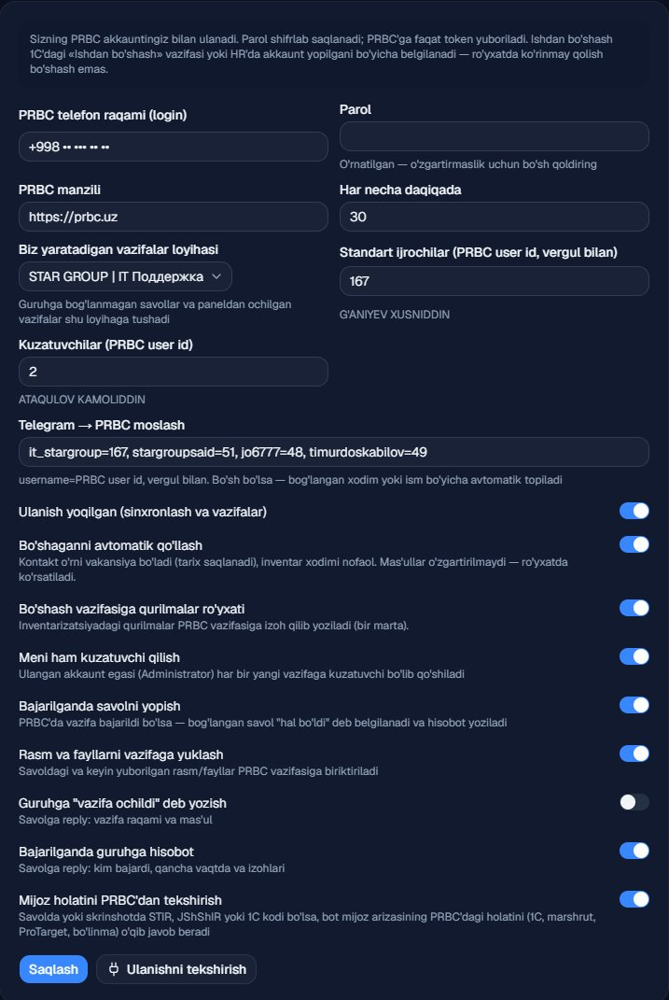

1. **PRBC telefon raqami va parol** — administratorning PRBC akkaunti (parol shifrlangan; o'zgartirmaslik uchun bo'sh
   qoldiring).
2. **Biz yaratadigan vazifalar loyihasi** — guruhga bog'lanmagan savollar uchun (hozir «STAR GROUP | IT Поддержка»).
3. **Standart ijrochilar** — boshqa hech kim topilmasa (PRBC user id; pastida ismi chiqadi).
4. **Kuzatuvchilar** — har vazifaga (Kamoliddin aka = 2).
5. **Telegram → PRBC moslash** — `username=PRBC id`, vergul bilan (masalan, `stargroupsaid=51`). Umumiy
   `it_stargroup` akkaunti ijrochi bo'lmaydi.
6. **Kalitlar:** ulanish yoqilgan, bo'shaganni avtomatik belgilash, qurilmalar ro'yxati, meni kuzatuvchi qilish,
   bajarilganda savolni yopish, fayllarni yuklash, guruhga "ochildi" / "bajarildi" xabari, **mijoz holatini
   PRBC'dan tekshirish**.
7. **Saqlash**, keyin **Ulanishni tekshirish** — qaysi PRBC manbalari ochiqligi ko'rsatiladi.

### 2.2 Vazifa nazorati (muddat)

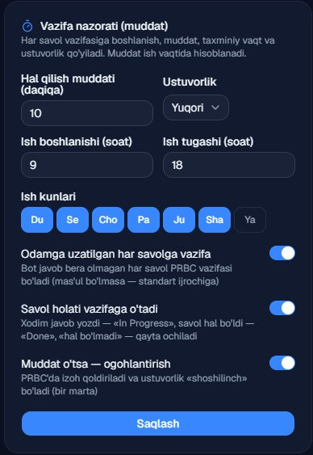

| Maydon | Hozir | Ta'siri |
|---|---|---|
| Hal qilish muddati | 10 daqiqa | Har vazifaga shu muddat qo'yiladi (ish vaqtida) |
| Ustuvorlik | Yuqori | PRBC'dagi priority |
| Ish boshlanishi / tugashi | 9 / 18 | Muddat faqat shu oraliqda hisoblanadi |
| Ish kunlari | Du–Sha | Yakshanbada kelgan savol muddati — dushanba 09:10 |
| Odamga uzatilgan har savolga vazifa | yoqiq | Bot javob bera olmagan har savol — vazifa |
| Savol holati vazifaga o'tadi | yoqiq | Javob yozildi → In Progress, hal bo'ldi → Done |
| Muddat o'tsa — ogohlantirish | yoqiq | PRBC'da izoh + "shoshilinch" |

O'zgartirgach **Saqlash** — keyingi vazifalardan amal qiladi.

### 2.3 Guruh → PRBC loyiha (vazifa, loyiha, ijrochi)

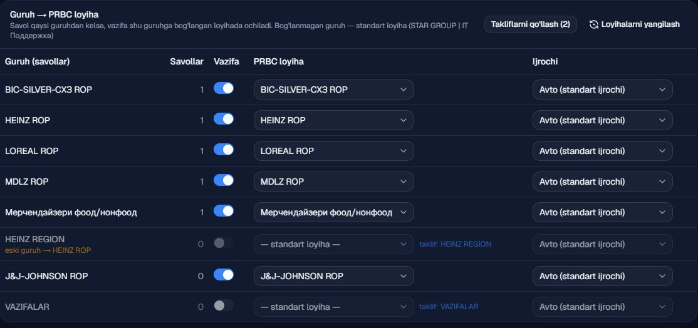

Har qatorda:
- **Vazifa** — shu guruhdan vazifa ochiladimi (VAZIFALAR va eski guruhlar — o'chiq; eski guruh tagida
  "eski guruh → …" yozuvi).
- **PRBC loyiha** — vazifa qaysi loyihada ochiladi. Ko'k "taklif: …" — nomga qarab topilgan loyiha, bosilsa qo'yiladi;
  tepadagi **"Takliflarni qo'llash"** — hammasini birdan. **"Loyihalarni yangilash"** — PRBC'dan ro'yxatni qayta o'qish.
- **Ijrochi** — *Avto* (javob yozgan → mavzu mas'uli → toifa mas'uli → guruhda ko'p javob beradigan → standart;
  qavsda hozirgi avto tanlov) yoki aniq xodim.

### 2.4 Mijoz holatini tekshirish

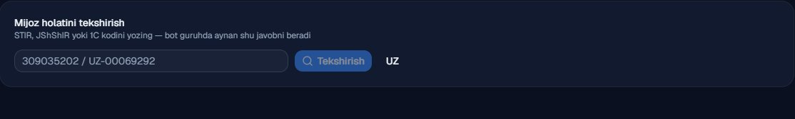

STIR, JShShIR yoki 1C kodini (UZ-…) yozib **Tekshirish** — bot guruhda aynan shu javobni beradi (UZ/RU almashtirish
mumkin).

---

## 3. Vazifalar nazorati

Support bot → PRBC vazifalar → **Vazifalar nazorati**.

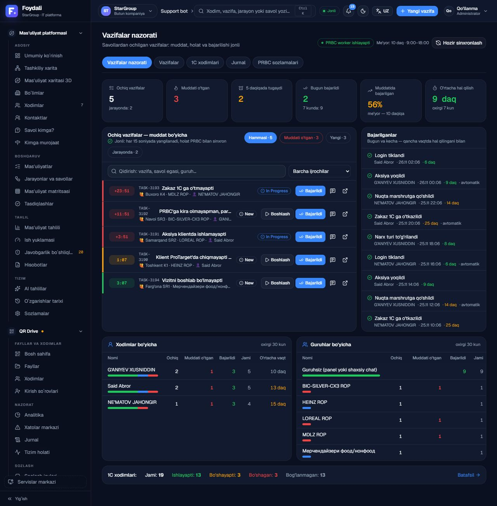

- Tepada ko'rsatkichlar: ochiq, muddati o'tgan, 5 daqiqada tugaydi, bugun bajarildi, muddatida %, o'rtacha vaqt.
- Ro'yxatda har vazifa: taymer (yashil / sariq / qizil +kechikish), kod, savol, kimdan va qaysi guruhdan, ijrochi,
  holat va tugmalar:

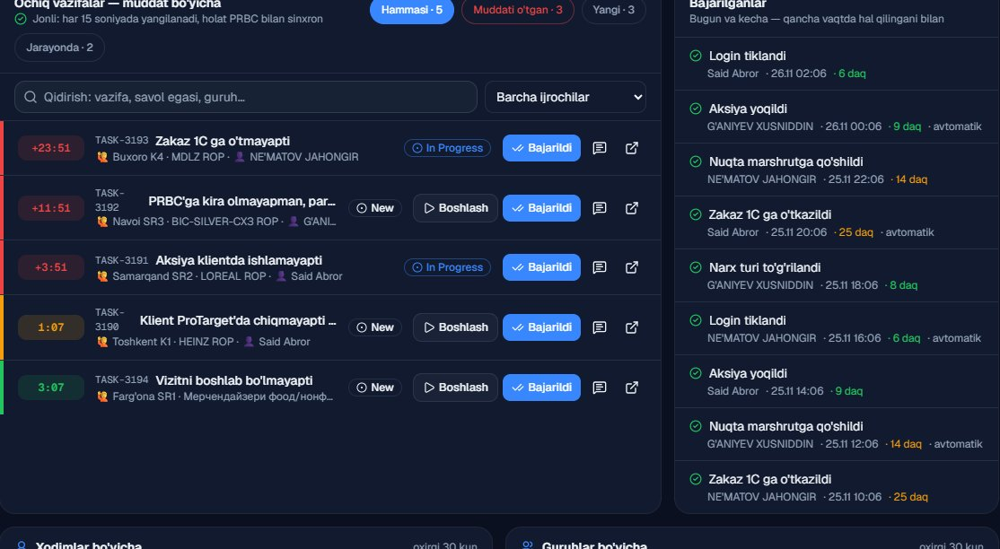

| Tugma | Nima qiladi |
|---|---|
| **▶ Boshlash** | PRBC'da "In Progress" (izoh: kim boshladi) |
| **✓ Bajarildi** | PRBC'da "Done"; savol ham yopiladi |
| 💬 | Guruhdagi savolni Telegram'da ochish |
| ↗ | Vazifani PRBC'da ochish |

- Filtrlar: Hammasi / Muddati o'tgan / Yangi / Jarayonda, qidiruv, ijrochi.
- Pastda: **xodimlar bo'yicha** va **guruhlar bo'yicha** statistika (30 kun) va 1C xodimlari qisqacha.
- Vazifasiz ochiq savol bo'lsa — sariq ogohlantirish va **"Hammasiga vazifa ochish"**.

### Vazifalar va 1C xodimlari

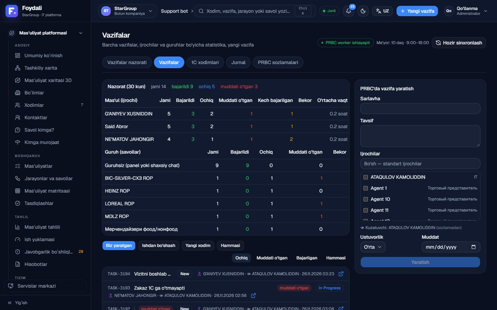

**Vazifalar** sahifasida jadvaldagi istalgan raqamni bosing — ro'yxat aynan shu xodim (yoki guruh) va shu holat bo'yicha
chiqadi. Masalan, xodimning "Kech bajarilgan" raqami:

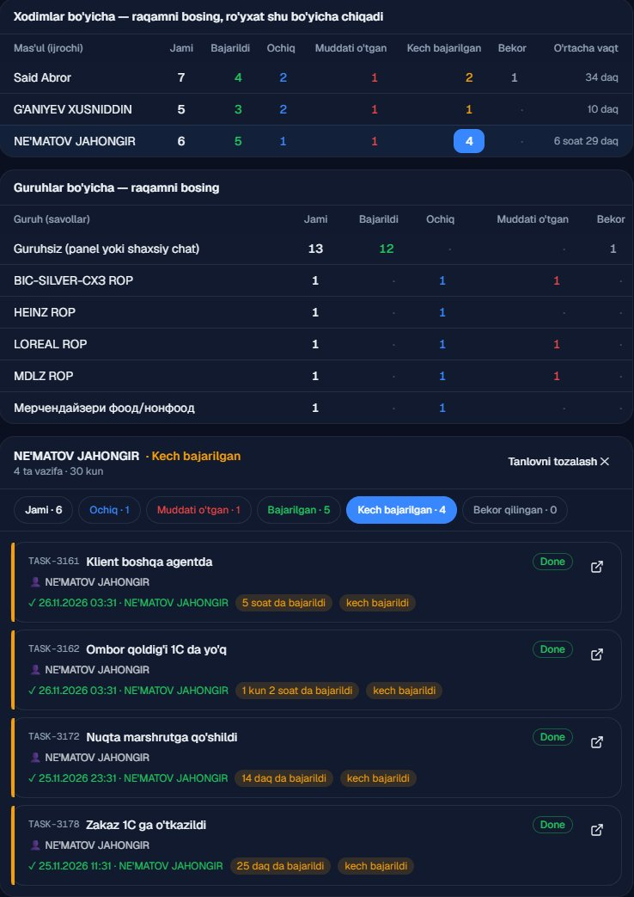

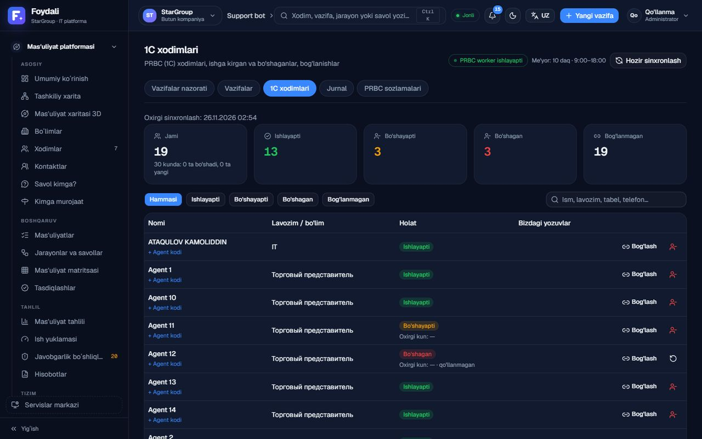

---

## 4. Bilim bazasi va tasdiqlash

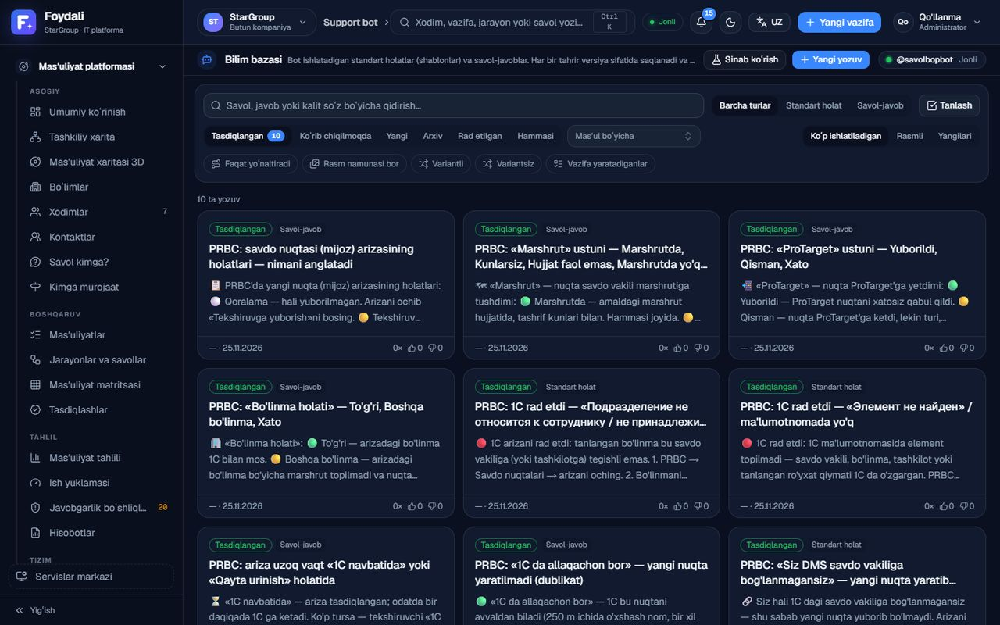

- **Yangi javob** — turi (savol-javob yoki standart holat), sarlavha, savol ko'rinishlari, shartlar, javob (uz/ru),
  mas'ul, "vazifa yaratiladi". Maydonlar ma'nosi — [Support bot bobi](/docs/support-bot#bilim-bazasi).
- Yozuvni ochib tahrirlang; har o'zgarish versiyada saqlanadi.

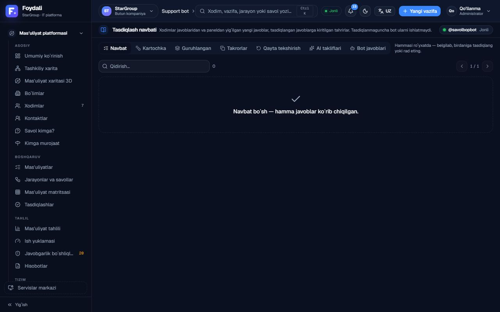

**Tasdiqlash navbati** — bot yoki xodimlar taklif qilgan yangi javoblar va tahrirlar: ✅ tasdiqlash yoki ❌ rad etish.

---

## 5. IT inventarizatsiya

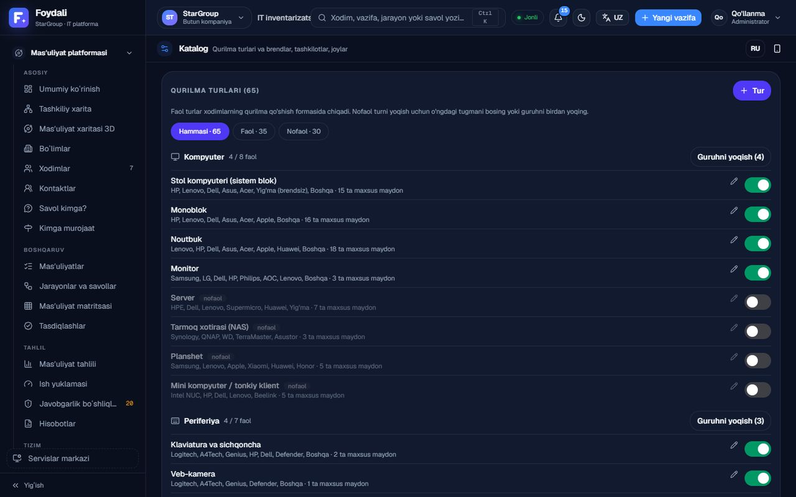

**Katalog** — tur yonidagi kalit bilan yoqish/o'chirish, "Guruhni yoqish", filtr (Hammasi / Faol / Nofaol), turni
ochib tahrirlash.

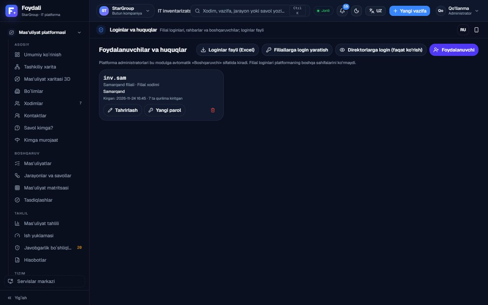

**Loginlar va huquqlar** — filiallarga va direktorlarga login yaratish, loginlar fayli (Excel), parolni tiklash.

---

## 6. Panel foydalanuvchilari va AI

Mas'uliyat platformasi → Tizim → **Sozlamalar**.

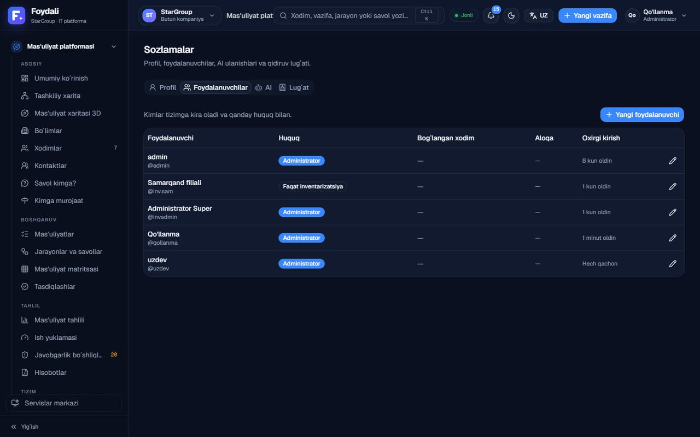

**Foydalanuvchilar** — panelga kim kiradi va qaysi rol bilan (administrator / muharrir / kuzatuvchi / faqat
inventarizatsiya).

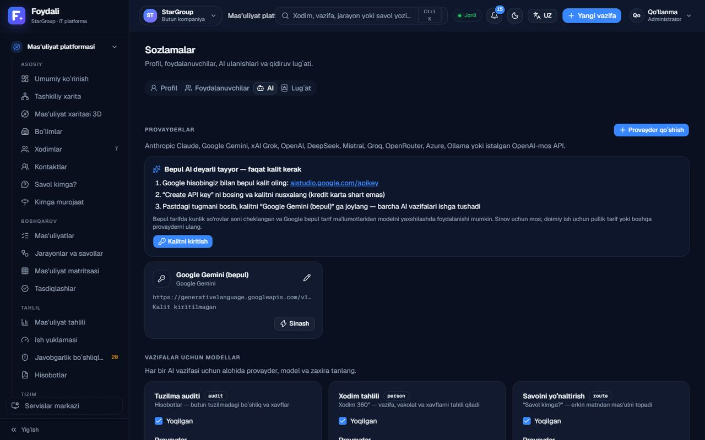

**AI** — provayderlar va kalitlar (shifrlangan), qaysi vazifaga qaysi model.

---

## Qo'llanmaning o'zi

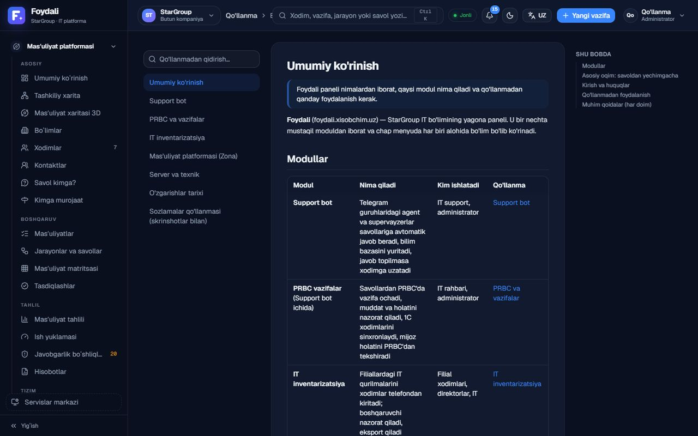

Chap menyu → **Qo'llanma**. Har o'zgarish bilan yangilanadi; [O'zgarishlar tarixi](/docs/ozgarishlar).
